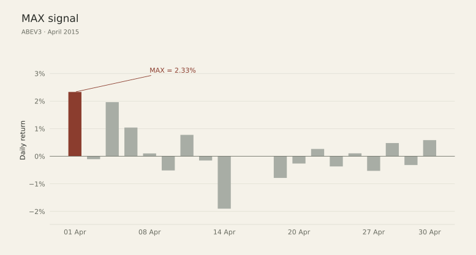
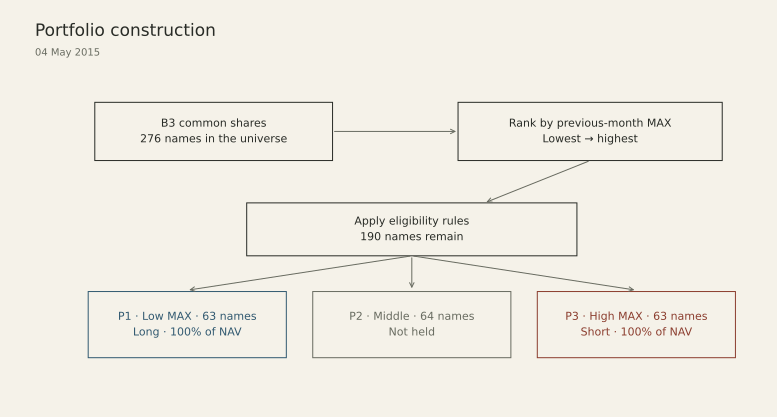
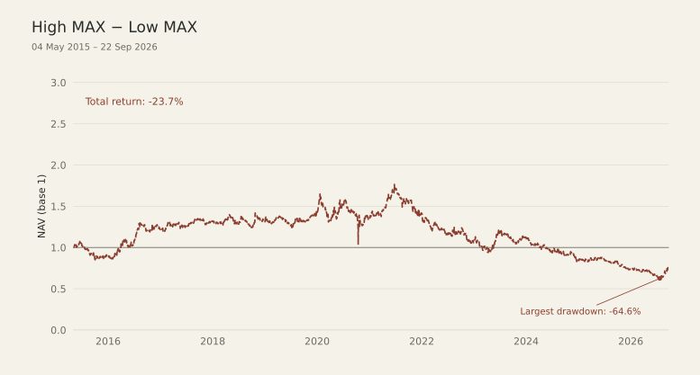
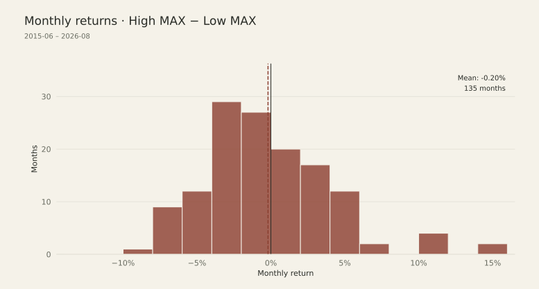
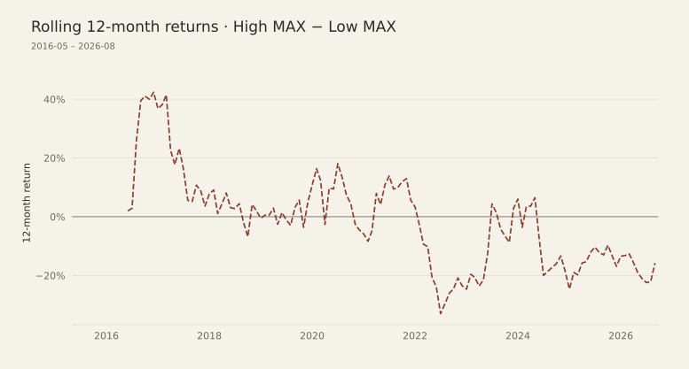
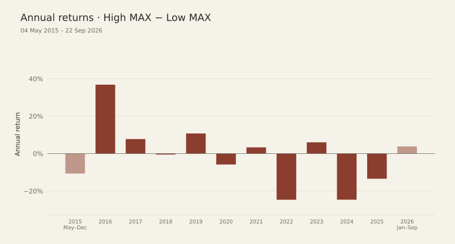
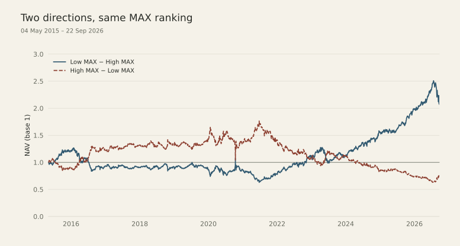

## A first post, finally

This is my first post here, and hopefully the first of many. I have a background in engineering and mathematics, work in quant, and spend some of my spare time reading papers for ideas. Eventually, I wanted somewhere to write about what happens when I try those ideas on B3. Most of this will probably be a conversation with my alter egos, but you're welcome to join in.

The aim isn't to reproduce each paper exactly. I want to take an idea, keep it reasonably close to its original form, and see how it behaves in the Brazilian market. There will be simplifications, changes to the original setup, and assumptions needed to run the simulations. I'll make those explicit in each study.

Each study will specify the portfolio construction, rebalancing and execution rules. Simulated returns will account for interest on cash, transaction costs and stock-borrow fees.

I'll start with simpler ideas, learn from the feedback, and gradually work towards more involved studies. This is also a chance to practise writing after years of being more comfortable with equations than paragraphs. I'd like the posts to be readable while still giving enough detail to follow the test and question its assumptions.

Everything here is independent research for study, not a recommendation to trade or follow a strategy. Reading about this stuff is a hobby; this blog is a way to take it a little further. If you have a question, criticism, or suggestion, I'd be happy to hear it. My contact details are on the [About page](../../about.qmd).

## The idea

Some stocks occasionally record a very large gain in a single day. For investors drawn to the possibility of an exceptional payoff, that can be part of their appeal. They may be willing to pay more for a small chance of a large gain, even at the expense of the average return they can expect. This preference for lottery-like payoffs is the motivation behind the study by @bali2011. Their measure, MAX, is simply the largest daily return a stock recorded during the previous calendar month.

In their U.S. sample, stocks with high MAX subsequently earn lower returns than stocks with low MAX. The result is consistent with the authors' interpretation: demand for the possibility of a large payoff may push prices up and expected returns down. @berggrun2019 examine the same idea in Brazil. They also find a negative MAX effect, with stronger evidence after adjusting for risk factors. I'll return to the differences between the two studies before describing my own test.

What I want to investigate here is whether that relationship between high- and low-MAX stocks is still present on B3 in a later sample. I'm using the papers as a starting point, rather than trying to reconstruct their historical samples exactly. From there, I'll examine a portfolio that buys low-MAX stocks and shorts high-MAX stocks, as well as the opposite direction. This lets me look at both the return difference associated with MAX and what remains of it under the financing, cost and execution assumptions of the simulation.

## Calculating MAX

For stock $i$ in calendar month $t$, the signal is defined as

$$
MAX_{i,t} = \max_{d \in t}\left(R_{i,d}\right),
$$

where $R_{i,d}$ is the stock's daily return on trading day $d$. The value computed from month $t$ is used to form the portfolio for month $t+1$. A portfolio formed at the start of May, for example, uses the daily returns observed during April.

{fig-alt="Daily returns for ABEV3 in April 2015, with the maximum daily return of 2.33% highlighted."}

The economic prediction concerns relative returns: stocks with higher MAX should earn lower returns in the following month than stocks with lower MAX.

That gives us two useful ways to express the same prediction. To report the anomaly, the usual convention is **High MAX − Low MAX**. If the relationship holds, the expected return spread is negative:

$$
\mathbb{E}\left[R^{\text{High MAX}}_{t+1} - R^{\text{Low MAX}}_{t+1}\right] < 0.
$$

To construct a strategy around that prediction, the direction is reversed: buy low-MAX stocks and short high-MAX stocks. The expected spread for **Low MAX − High MAX** is then positive:

$$
\mathbb{E}\left[R^{\text{Low MAX}}_{t+1} - R^{\text{High MAX}}_{t+1}\right] > 0.
$$

I'll use both conventions throughout the post: High MAX − Low MAX when comparing the effect with the papers, and Low MAX − High MAX when examining the strategy suggested by it. For the raw return spread, reversing the direction changes only the sign. For the simulated portfolios, each direction has its own costs and cash flows, so their net returns need to be calculated separately.

## The original U.S. study

Bali, Cakici and Whitelaw study NYSE, Amex and Nasdaq stocks from July 1962 to December 2005. Each month, they calculate MAX from the previous calendar month's daily returns and sort stocks into ten deciles. Portfolio 1 contains the lowest-MAX stocks, and portfolio 10 the highest. They hold the portfolios for the following month, rebalance monthly, and report both equal-weighted and value-weighted returns.

For the equal-weighted portfolios, the average **Low MAX − High MAX** return spread is about **0.65% per month**, with a Newey–West t-statistic of **1.83**. In the paper's High MAX − Low MAX convention, those figures are −0.65% and −1.83. The value-weighted spread is larger, at about **1.03% per month** in the low-minus-high direction.

The paper also reports alphas from the Fama–French–Carhart four-factor model, which accounts for market, size (SMB), value (HML) and momentum (MOM) exposures. To keep this first post simple, I'll focus on raw long–short returns and Newey–West inference [@newey1987]. The return spreads in my comparison will therefore be unadjusted for these factors.

## The study in Brazil

Berggrun, Cardona and Lizarzaburu examine Brazilian common stocks from July 2001 to August 2014, including delisted stocks to reduce survivorship bias. Their returns are expressed in U.S. dollars. With a much smaller equity universe than in the U.S., they divide stocks into three groups: P1 contains the lowest-MAX stocks, P2 the middle group, and P3 the highest-MAX stocks. This use of terciles is also the basis for the portfolio construction in my B3 test.

The authors report both equal-weighted and value-weighted portfolios. Their main comparison takes the return on the high-MAX group minus the return on the low-MAX group:

$$
P3 - P1 = \text{High MAX} - \text{Low MAX}.
$$

For the equal-weighted portfolios, the raw spread averages about **−0.40% per month**, with a **p-value of 0.276**. The direction is consistent with the U.S. finding, though the statistical evidence in the raw spread is weak. After the Carhart adjustment, the estimated alpha is about **−0.80% per month**, with a **p-value of 0.014**.

The study also removes monthly observations with returns above 300% and winsorizes the monthly data at the 0.5th and 99.5th percentiles to limit the influence of extreme observations. These choices, together with the use of terciles, provide a useful reference for adapting the test to the local market.

## My test on B3

My sample covers B3 common stocks from **May 2015 to September 2026**, with the simulated portfolio series running from 4 May 2015 to 22 September 2026. Returns are measured in Brazilian reais. The Brazilian paper's sample ends in August 2014, so this test extends the idea into a later period and asks whether the relationship persists.

The portfolios rebalance on the first trading session of each month. Eligibility includes a trading-activity check over the latest 42 observations, requiring trading activity throughout the available window.

I require regular trading activity to make monthly rebalancing more plausible. Both low- and high-MAX stocks must pass the same screen. If the MAX effect is stronger among stocks that trade infrequently, this restriction could reduce the spread observed in my sample.

At each rebalance, I select the bottom and top thirds of the eligible MAX ranking, rounding the number of stocks on each side down to a whole number. Using terciles follows the Brazilian study and spreads each side across a broader set of stocks in B3's smaller universe. The Low MAX − High MAX portfolio buys the lower tercile and shorts the upper tercile; the opposite portfolio swaps those positions. Each targets a long exposure of 100% of NAV and a short exposure of 100%, giving 200% gross exposure and zero net exposure at the target weights.

Within each side, stocks receive equal target weights at rebalancing. This gives each name the same initial allocation and makes the equal-weighted results in both papers the relevant reference. The allocation remains spread across the selected stocks regardless of differences in market capitalization.

{fig-alt="Portfolio construction at the first rebalance: 276 B3 common stocks, 190 eligible names, and terciles containing 63, 64 and 63 stocks."}

Before ranking, I winsorize the cross-section of MAX values using the **0.5th and 99.5th percentiles**. Values outside those thresholds are capped at the lowest and highest observations within them. This carries over the Brazilian study's percentile cutoffs, applied here to the MAX signal. Ties are resolved using traded share quantity, with higher quantity receiving priority in the ranking.

Stocks with monthly returns above 300% remain in the sample, subject to the same eligibility rules as other stocks. Winsorization acts on the signal used for ranking; the returns realized by the portfolios retain those extreme observations.

## The main differences

| Choice | U.S. paper | This study |
|:--|:--|:--|
| Market | U.S. equities | B3 common stocks |
| Period | 1962–2005 | 2015–2026 |
| Buckets | Deciles | Terciles |
| Weighting | Equal and value weighted | Equal weighted |
| Risk adjustment | Raw spreads and Carhart four-factor alphas | Unadjusted spreads |
| Winsorization | Absent from the baseline sort | 0.5th / 99.5th percentiles of MAX |
| Trading costs, borrow and cash interest | Raw portfolio returns | Included in the fund simulation |

The extra step is to see how the return spread translates into a fund's return. Interest on cash can support performance even when the MAX spread is weak, while trading and borrowing costs reduce it. I'll use the raw spreads for the paper comparison and discuss these implementation effects separately.

## High MAX − Low MAX

For the first run, I bought the high-MAX tercile and shorted the low-MAX tercile, keeping the same high-minus-low convention used in the papers. I included the fund mechanics from the start: interest on cash, transaction costs and stock-borrow fees paid when positions are covered.

There are profitable stretches here, especially in the earlier years. By September 2026, though, the initial R$1 million had fallen to about **R$763,000**, a **23.7% loss**. The worst drawdown reached **64.6% below a previous peak** in July 2026.

{fig-alt="High MAX minus Low MAX portfolio NAV from May 2015 to September 2026, with a total return of minus 23.7% and a maximum drawdown of minus 64.6%."}

| Measure | High MAX − Low MAX |
|:--|--:|
| Mean monthly return | −0.20% |
| Newey–West(4) standard error | 0.39% |
| Newey–West(4) t-statistic | −0.50 |
| Two-sided p-value | 0.61 |
| Total return | −23.7% |
| CAGR | −2.35% |
| Maximum drawdown | −64.6% |

Even after that loss, the monthly mean is estimated quite imprecisely. It comes to **−0.20%**, with a standard error of **0.39%** and a p-value of **0.61**. I wouldn't take that as strong evidence of a negative expected fund return. And because the account includes costs and cash interest, I'll need the raw stock-return spreads before comparing the result directly with the papers.

The histogram uses **135 completed months, from June 2015 to August 2026**, which are also the observations used in the monthly test. The full-period figures use the daily series, with CAGR calculated over the elapsed calendar time.

{fig-alt="Distribution of 135 monthly returns for High MAX minus Low MAX, with zero and the mean of minus 0.20% marked."}

I also wanted to see how often a full year in this portfolio would have been profitable. The rolling 12-month returns are positive for much of the early sample, change sign several times, and spend the final stretch below zero.

{fig-alt="Rolling 12-month returns for High MAX minus Low MAX, calculated from completed calendar months."}

In calendar-year terms, **2016 gained 36.8%**, while **2022 lost 24.7%** and **2024 lost 24.6%**. So there were years when holding this side worked quite well, followed by years that gave back a substantial amount of money.

{fig-alt="Annual returns for High MAX minus Low MAX, with partial periods labeled for May to December 2015 and January to September 2026."}

## Low MAX − High MAX

For the second run, I swapped the positions: buy low MAX, short high MAX. This is the direction I'd use to test a strategy based on the paper's finding that high-MAX stocks subsequently underperform.

Bali and coauthors discuss exactly this in their conclusion, when considering why other investors haven't traded the effect away. Exploiting it “would require shorting stocks with extreme positive returns” [@bali2011, p. 445]. They point to the difficulty or reluctance to sell short, and to the fact that these stocks tend to be small and illiquid. Trading costs could make the strategy difficult to implement. In my inverted portfolio, those high-MAX stocks are precisely the ones I need to borrow and sell short.

This time, the initial R$1 million grows to about **R$2.07 million**. That's a **107.3% return**, or **6.61% a year**, over a little more than eleven years. I've put both runs on the same chart so we can follow the two directions through the same periods.

{fig-alt="Both simulated portfolios normalized to one in May 2015. By September 2026, Low MAX minus High MAX reaches approximately 2.07 and High MAX minus Low MAX approximately 0.76."}

| Measure | Low MAX − High MAX |
|:--|--:|
| Mean monthly return | +0.73% |
| Newey–West(4) standard error | 0.42% |
| Newey–West(4) t-statistic | 1.74 |
| Two-sided p-value | 0.082 |
| Total return | +107.3% |
| CAGR | +6.61% |
| Annualized volatility | 16.8% |
| Maximum drawdown | −50.4% |
| Winning months | 64.4% |
| Trailing 3-year annualized return | +22.52% |
| Trailing 5-year annualized return | +24.27% |
| Trailing 10-year annualized return | +8.45% |

There's some evidence of a positive expected fund return, but it's modest: the test reaches significance at **10%**, but falls short of the usual **5%** threshold. I'd want to see how the result holds up in another sample before relying much on that average.

The part I'd find hardest to live with is the **50.4% drawdown**. By June 2021, the portfolio had lost about half its value from its previous peak. The recovery and much of the gain came later. That's why the three- and five-year annualized returns are above 20%, while the full-period CAGR is 6.61%: they cover a much better stretch of the same strategy.

I've kept the same 135 months and annualization conventions for both portfolios. The trailing windows end on 22 September 2026; volatility uses daily simple returns and 252 trading sessions per year.

There is still some accounting to do before attributing the gain to MAX. Both portfolios pay trading costs, but they borrow different stocks and earn interest on different cash balances as their positions change. Returns also compound differently in each run. Next, I'll separate those amounts so we can see how much came from the stocks and how much came from running the portfolio.

## The spread and the fund

The cash account is one reason I wanted both versions of this test. If the gains and losses on the stocks roughly cancel out, the cash can still earn interest. A positive fund return could therefore owe quite a lot to CDI, even with a weak MAX spread.

For the comparison with the papers, I start with the difference between the monthly returns of the two groups:

$$
R_{\text{spread}} = R_{\text{Low MAX}} - R_{\text{High MAX}}.
$$

That is where I look for evidence that low-MAX stocks subsequently outperform high-MAX stocks. Once I put those positions into a simulated fund, the account also has trading expenses, borrowing fees and interest on cash. The daily return can be summarized as

$$
R_{\text{fund}}
\approx R_{\text{long-short}}
+ R_{\text{cash}}
- C_{\text{borrow}}
- C_{\text{trading}}
- C_{\text{slippage}}.
$$

Here, the terms represent contributions relative to the fund's NAV. The stock contribution depends on the positions actually held and their execution prices; the full-period return comes from compounding the daily fund returns.

For these runs, I used the following assumptions:

| Item | Assumption |
|:--|:--|
| Cash interest | CDI applied to the cash balance |
| Stock borrowing | Available daily borrow rates, with a 4.5% annual fallback, applied to short market value |
| Trading costs | 10 bps of traded value on each purchase or sale |
| Slippage | 0 bps |

The **4.5% borrow rate is a fallback**: whenever the dataset provides a rate for the stock on that date, the simulation uses it. Reversing the portfolio changes which stocks I borrow and the rates I pay. Borrow fees accumulate daily and are paid as short positions are covered. The NAV shown above recognizes those payments; outstanding fees are tracked separately, along with a NAV series that deducts them.

I set slippage to zero to keep this first test simple. That makes the execution assumptions optimistic. Each purchase or sale costs 10 bps of traded value, so costs increase with turnover.

CDI belongs to the return on cash held alongside the positions. The MAX effect is the return difference between the stock groups. I want to judge that difference on its own first, then see what it leaves after paying to trade and borrow the stocks. Cash interest contributes to the fund's total return, but I'd give the stock selection credit only for what comes from the positions themselves.

## Back to the Brazilian paper

With the fund results out of the way, I can return to the comparison that motivated the test. I took the same monthly stock groups selected for the simulation, calculated their returns with equal weights at formation, and held those allocations through the month. Subtracting the low-MAX group's return from the high-MAX group's return gives the raw spread to compare with the papers. I've put both studies alongside my results below, with the B3 spread shown in both directions. All four columns use equal-weighted returns, before the fund's cash interest and costs.

| Result | U.S. EW | Brazil EW | B3 replication sign | B3 tradable sign |
|:--|:--|:--|:--|:--|
| Portfolio direction | High − Low | High − Low | High − Low | Low − High |
| Monthly mean | −0.65% | About −0.40% | −0.53% | +0.53% |
| NW t-stat | −1.83 | Not reported | −1.31 | +1.31 |
| p-value | Not reported | 0.276 | 0.191 | 0.191 |
| Sample period | Jul 1962–Dec 2005 | Jul 2001–Aug 2014 | May 2015–Aug 2026 | May 2015–Aug 2026 |
| Monthly observations | 522 | Not reported | 136 | 136 |

: Main empirical results: raw monthly MAX spreads.

The paper returns are in USD; mine are in BRL. The B3 tests use Newey–West standard errors with four lags. “Not reported” marks statistics the papers do not supply for their raw spread, including the Brazilian spread's observation count.

I get the same direction in the later sample: high-MAX stocks earn less on average. The raw-return tests also have something else in common: the statistical evidence is weak. My estimate is a little more negative, but a p-value of **0.191** leaves limited evidence that the expected spread differs from zero. I'd also keep the different periods and currencies in mind when comparing the magnitudes, alongside the portfolio choices described earlier.

The raw calculation has **136 complete months**, including May 2015, whose return can be measured from the previous month's closing prices. Restricting it to the same 135 months used in the fund tests gives **−0.56% per month**, with a p-value of **0.179**. That leaves the reading broadly unchanged.

### A check using both runs

I also tried a simple calculation using the two simulated portfolios. Suppose their returns could be written as a shared contribution $C$ plus or minus a stock-return component $S$:

$$
R_{+} = C + S,
\qquad
R_{-} = C - S,
$$

where $R_{+}$ is the Low MAX − High MAX fund return and $R_{-}$ is the opposite direction. Then

$$
S = \frac{R_{+}-R_{-}}{2},
\qquad
C = \frac{R_{+}+R_{-}}{2}.
$$

Applying that arithmetic to the **135 paired monthly returns**, the half-difference averages **+0.46% per month**, and the half-sum averages **+0.27%**. The +0.46% is close to the paper's +0.40% after reversing its reporting sign, which makes it tempting to read the half-difference as the MAX effect.

I would stop short of that interpretation. Calling $S$ the stock-return component requires the other contributions to match across the two runs. Here, borrowing fees, cash balances, trading and position sizes differ between directions. The half-difference picks up some of those differences too. I keep it as an additional diagnostic; the comparison with the paper rests on the **directly calculated raw spread of −0.53% per month**.

## A few limits

I'd be careful about extending these results beyond this B3 sample. Other periods and portfolio weights could give a different answer. With fewer stocks to work with, individual names can also have more influence, even when using terciles. And since I left the Carhart tests out to keep this first post simple, I haven't established how much of the spread remains after controlling for those risk factors.

There's also the distance between simulating a trade and getting it done. The borrowing rates in the data don't guarantee that I could have borrowed every stock, in the required quantity, at those rates. The 4.5% fallback fills gaps in the rate history; it doesn't establish availability. Zero slippage is another optimistic simplification. In live trading, *results may vary*. I did put it in the name.

Stocks that were later delisted remain in the dataset with their available price histories. When calculating the raw monthly spreads, I use the last available adjusted close to value a position if its quote is missing. Around a suspension or delisting, that price can differ from the amount a shareholder ultimately receives.

## Wrapping up

I came to this test wondering whether the MAX idea would show up in a later B3 sample. On average, it does point in the same direction: high-MAX stocks underperform low-MAX stocks. The raw spread is close in magnitude to the earlier Brazilian estimate and smaller than the U.S. equal-weighted result. There's considerable uncertainty around my estimate, though, so I'd be cautious about expecting that average to persist.

The trading result is less encouraging. From 4 May 2015 to 22 September 2026, the Low MAX − High MAX portfolio gained **107.3%**, against **190.3% for CDI** and **231.8% for Ibovespa**. It fell short of both benchmarks even with interest on cash included, while suffering a **50.4% drawdown**. Add the modest statistical evidence, and I see little in this run to justify the complexity of maintaining the long–short portfolio.

What keeps me interested is how far such a simple idea travels: rank stocks by a single day's gain, then look at what happens over the following month. Decades after the original U.S. sample, the average relationship still points the same way here. For a first post, that gives me plenty to think about and a reason to keep reading and testing.

## References

::: {#refs}
:::
